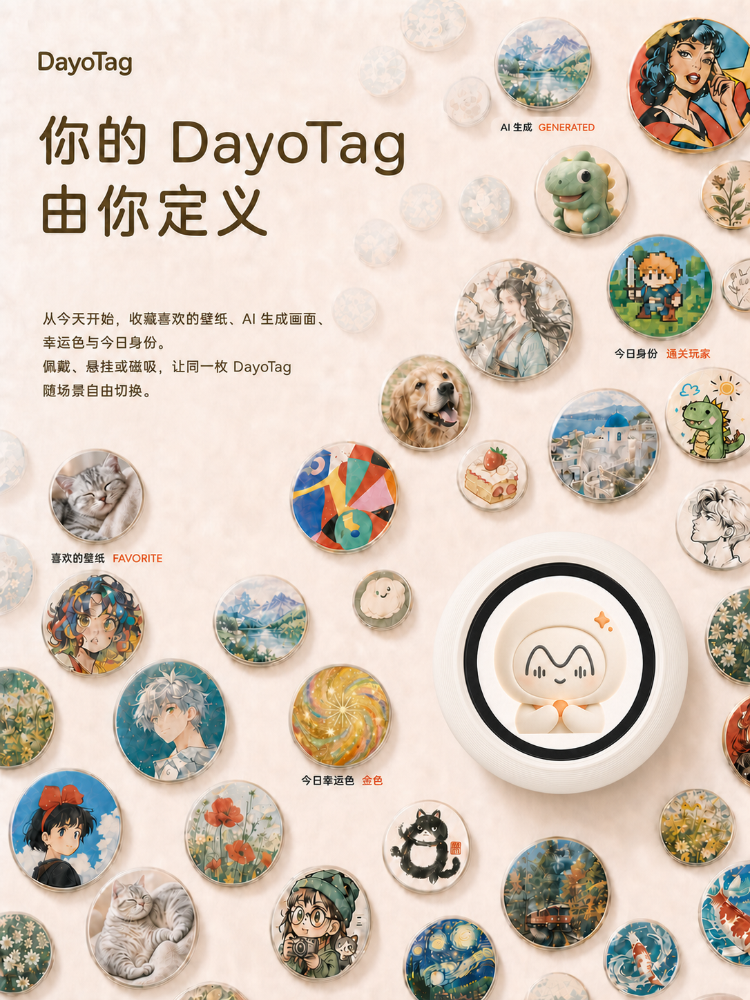
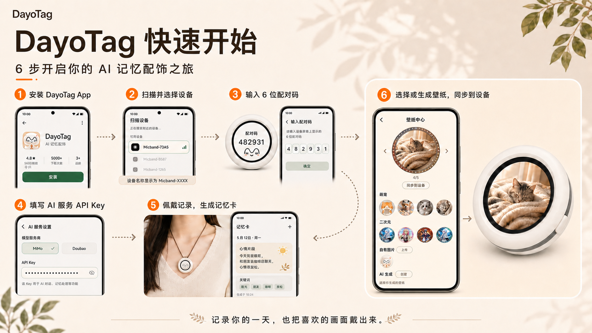

<h1 align="center">DayoTag</h1>

  24H AI 记忆配饰 · 官方 APK、固件与使用说明

  听见 → 留住 → 沉淀 → 共鸣 → 生长

  简体中文 | <a href="README.en.md">English</a>

## 一枚越戴越懂你的 AI 记忆配饰

**把今天真正重要的，重新交还给你。**

DayoTag 是一枚24H AI记忆个性化配饰，并配备记忆Agent。它把一天里自然发生的声音和重要时刻，整理成可回看、可追问、可继续行动的个人记忆；戴得越久，也越懂你。

**立即开始：** [下载 Android APK](https://github.com/Tobey0727/DayoTag/releases) · [查看使用指南](docs/USER_GUIDE.md) · [查看硬件资料](https://oshwhub.com/eda_kqtkoxdx/project_bpeoomns) · [反馈问题](https://github.com/Tobey0727/DayoTag/issues) · [加入交流群](#联系与交流)

  

## 记忆由你掌控

DayoTag 记录的是你生活中最真实的每天

- **设备手机实时同步：** 手机不在身边时也能继续记录，重新连接后会立刻通过蓝牙直接同步到自己的手机。
- **端侧存储隐私可控：** DayoTag是纯端侧APP，所有数据全保存在本地、没有任何云服务，你可以通过端侧ASR本地完成语音转文字，也可以自由配置远程ASR服务（效果更佳）。
- **自由选择Agent大脑：** 记忆Agent的使用方法与openclaw等主流Agent一致，由你自由选择信任的大模型服务商提供的API服务。

## 每日个性搭配

DayoTag 的低功耗彩色屏不只是状态显示，也是属于你的个性化表达入口。喜欢的壁纸、今日身份、幸运色和 AI 生成画面，都可以从 App 同步到设备，让同一枚 DayoTag 随心情、场景和每一天自由变化。

  

## 从记录一天，到真正记住一天

1. **听见：** 设备在现场低负担记录，重要时刻可以随手标记。
2. **留住：** 内容先保存在 DayoTag，手机重新靠近后再增量同步。
3. **沉淀：** App 把零散声音整理成 Today 卡片和可回看的 Memory。
4. **共鸣：** 想不起时直接询问自己的记忆，也可以让 Skill 把结果变成待办和后续行动。
5. **生长：** 短期记忆持续沉淀为长期记忆，让 Agent 在用户可控的范围内逐渐理解关注、偏好和变化。

## 开始使用 DayoTag

  

第一次使用时，按图完成 App 安装、设备绑定、处理方式选择和壁纸同步。需要 Android 7.0 或更高版本，并开启蓝牙；使用云端模型时，还需要网络和自己的模型 API Key。

安装前请从 [GitHub Releases](https://github.com/Tobey0727/DayoTag/releases) 下载最新 APK，并核对对应的 SHA-256。完整权限说明、操作步骤和常见问题见[用户使用指南](docs/USER_GUIDE.md)；首次写入或故障恢复见[固件串口烧录指南](docs/FIRMWARE_FLASHING.md)。

## 当前已经跑通

| 环节 | 当前能力 |
|---|---|
| 设备 | 本地录音、存储、重要时刻标记和状态显示 |
| 连接与维护 | 蓝牙绑定、认证、增量同步、App 内 OTA 和后台恢复 |
| 记忆与 Agent | 音频转写、Today、历史 Memory、Agent 问答和多种 Skill |
| 可穿戴表达 | 壁纸、身份内容和圆形卡片同步 |

## 资料与参与

| 你要找什么 | 入口 |
|---|---|
| APK、设备固件和更新记录 | [GitHub Releases](https://github.com/Tobey0727/DayoTag/releases) |
| 安装、配对和日常使用 | [用户使用指南](docs/USER_GUIDE.md) |
| 产品定位与隐私说明 | [产品白皮书](docs/PRODUCT_OVERVIEW.md) · [隐私说明](docs/PRIVACY.md) |
| 手动串口烧录固件 | [固件串口烧录指南](docs/FIRMWARE_FLASHING.md) |
| 原理图、BOM、PCB、结构和复刻资料 | [嘉立创开源硬件平台](https://oshwhub.com/eda_kqtkoxdx/project_bpeoomns) |
| 问题反馈和功能建议 | [GitHub Issues](https://github.com/Tobey0727/DayoTag/issues) |
| 致谢与文档参考 | [ACKNOWLEDGEMENTS](ACKNOWLEDGEMENTS.md) |

## 联系与交流

- **微信交流群：** `DayoTag`
- **联系邮箱：** `dayotag0728@gmail.com`
- **问题反馈与功能建议：** [GitHub Issues](https://github.com/Tobey0727/DayoTag/issues)

  <strong>飞书交流群</strong>
   
  使用飞书扫描下方二维码加入
    
  

**开源说明：** DayoTag 是一个 AI 硬件开源项目。硬件资料在[嘉立创开源硬件平台](https://oshwhub.com/eda_kqtkoxdx/project_bpeoomns)按项目页所列协议开放；Android APK 与设备固件通过 GitHub Releases 免费提供。

**录音与安全：** 使用录音能力前，请遵守所在地法律，并在需要时获得在场人员同意。请勿在 Issue 中提交录音、转写、API Key 或设备标识；安全问题请发送至 `dayotag0728@gmail.com`。

**授权说明：** 项目由 [Tobey0727](https://github.com/Tobey0727) 以个人主体发布。APK、固件、文档、图片、第三方组件和硬件资料可能适用不同条款，详见 [LICENSE.md](LICENSE.md)、[ASSET_LICENSES.md](ASSET_LICENSES.md)、[NOTICE.md](NOTICE.md) 和 [THIRD_PARTY_NOTICES.md](THIRD_PARTY_NOTICES.md)。

Copyright © 2026 Tobey0727
